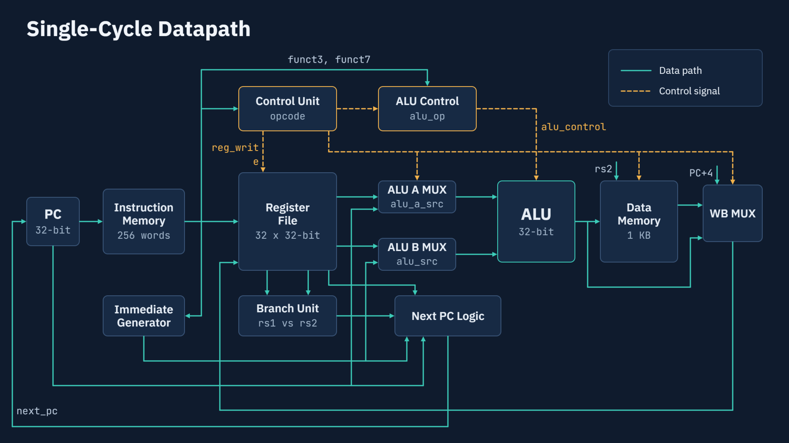
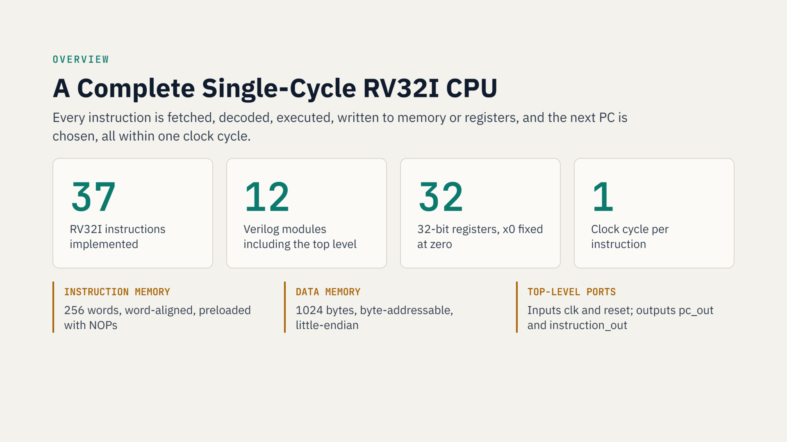
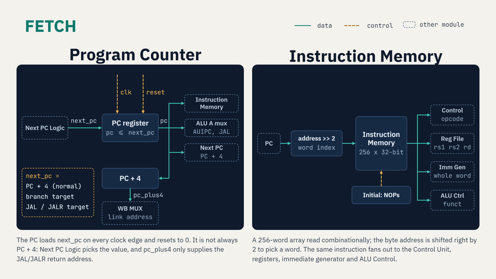
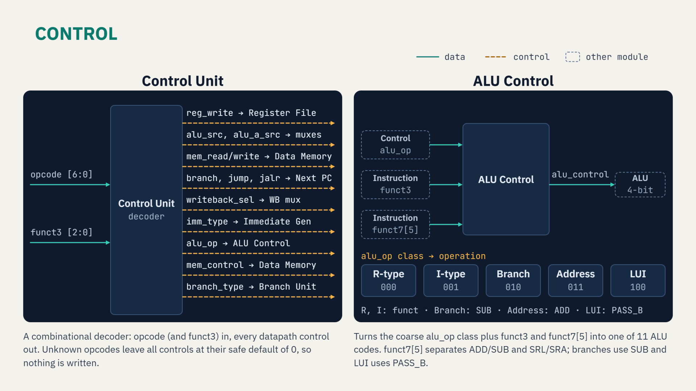
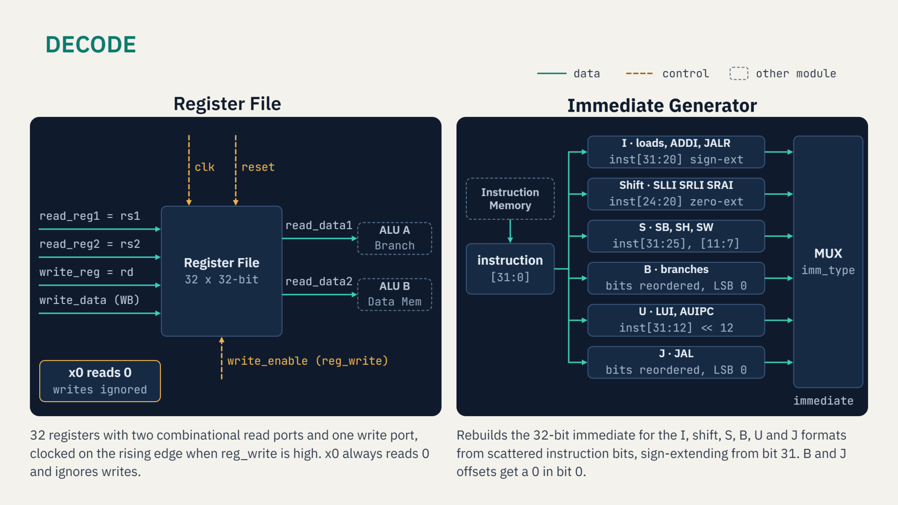
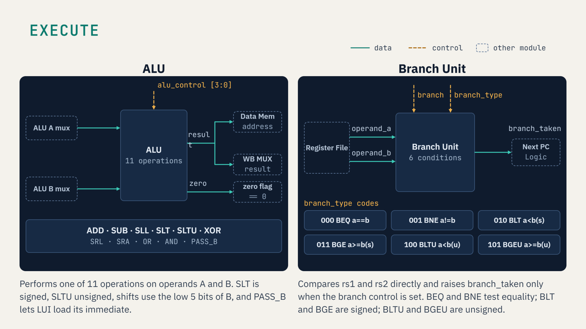
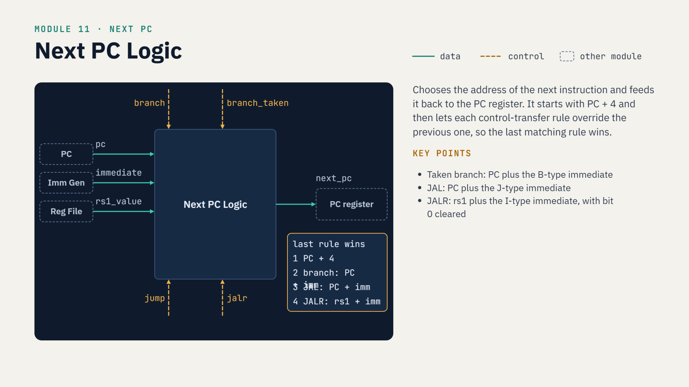
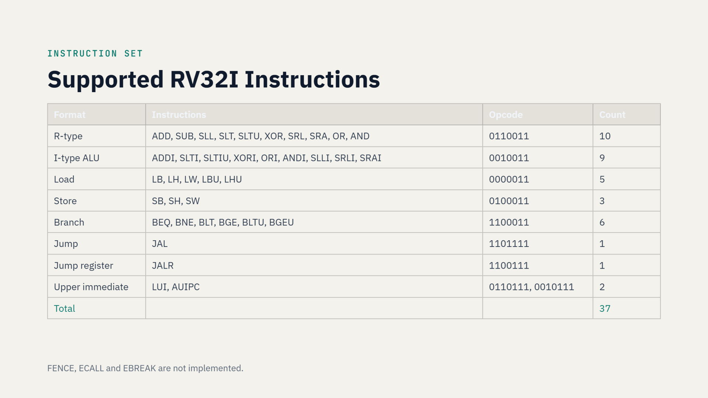

# RV32I Single-Cycle Processor

built this for my COA assignment. its a legit working CPU written in Verilog — not pseudocode, not fake, actual hardware description that you can simulate and see it run instructions for real.

if you don't know what any of this means, don't panic. i'll explain everything from scratch. by the end of this you'll actually get it.

---

## wait, what even is a processor?

ok so basically a processor is a machine that reads instructions and executes them. you write code in C or Python, the compiler turns it into tiny machine instructions, and the CPU just... runs them. one by one. forever. until you turn it off.

**RISC-V** is an open-source instruction set architecture — basically the "language" that the CPU understands. think of it like an API but for hardware. RV32I is the simplest version: 32-bit, base integer instructions only. no floating point, no fancy extensions. clean. simple. perfect for building from scratch.

**single-cycle** means every instruction takes exactly one clock cycle to finish. the CPU reads the instruction, does all the work, writes the result — all in a single tick of the clock. yes it's slow compared to real CPUs (which pipeline instructions), but it's dead simple to understand and build, which is exactly the point.

---

## the big picture — one instruction, one cycle

here's what the CPU does every single clock cycle:

```
fetch -> decode -> execute -> memory access -> writeback -> repeat
```

fetch the instruction from memory. decode what it wants. execute (do math, or memory op, or branch). write the result back. move PC to next instruction. that's it. that's the whole CPU.



that diagram above is literally the entire CPU. every box is one Verilog module in this repo. the green lines are data flowing, the orange dashed lines are control signals telling each module what to do.

---

## project at a glance



37 instructions. 12 modules. 32 registers. 1 clock cycle per instruction. that's the whole thing.

---

## the modules — what the hell does each one do

### pc.v — Program Counter

dumbest module in the whole project. literally just a 32-bit register. holds the address of the instruction that's running right now.

on every clock edge it updates to `next_pc`. on reset it goes to address 0 (start of memory). that's it.



### instruction_memory.v — where the program lives

a 256-word read-only memory (ROM). you load your program in here. CPU sends it an address (from PC), it spits back the 32-bit instruction at that address. word-addressed so address >> 2 to convert from byte address.

### control_unit.v — the boss

reads the opcode (7 bits at the bottom of the instruction) and decides what every other module should do. it doesn't compute anything itself. it just sets a bunch of control signals.

things it decides:
- should we write to a register after this?
- is the ALU getting data from a register or an immediate value?
- is this a load? a store? a branch? a jump?
- what type of immediate encoding does this instruction use?



### register_file.v — the scratchpad

32 registers, each 32 bits wide. when you write RISC-V assembly you use names like x1, x2, x3... these are those registers. you can read two at once (needed for `add x3, x1, x2` which needs x1 and x2 at the same time). one write port.

x0 is special — always reads as zero, writes to it do nothing. hardwired in hardware. that's the spec.

reads are instant (combinational). writes happen on the clock edge.

### immediate_generator.v — bit reshuffling chaos

some instructions carry a constant value baked into the instruction bits themselves — called an "immediate". but RISC-V encodes immediates differently depending on instruction type (I, S, B, U, J formats) and the bits are scattered all over the place.

this module collects those scattered bits, reassembles them in the right order, and sign-extends to 32 bits. it's basically just a giant case statement of bit operations.



### alu_control.v — two-level decoding

the control unit says "do an R-type ALU operation". but which one? ADD? SUB? XOR? that depends on funct3 and funct7 fields inside the instruction.

this module takes the high-level `alu_op` + `funct3` + `funct7[5]` and spits out a precise 4-bit code that tells the ALU exactly what operation to run. two levels of decoding — standard textbook approach, keeps things clean.

### alu.v — does the actual math

two 32-bit inputs in, one 32-bit result out. 11 operations:

| code | operation | used by |
|------|-----------|---------|
| ADD | a + b | ADD, ADDI, loads, stores, AUIPC, JAL |
| SUB | a - b | SUB |
| SLL | a << b[4:0] | SLL, SLLI |
| SLT | 1 if a < b (signed) | SLT, SLTI |
| SLTU | 1 if a < b (unsigned) | SLTU, SLTIU |
| XOR | a ^ b | XOR, XORI |
| SRL | a >> b[4:0] logical | SRL, SRLI |
| SRA | a >>> b[4:0] arithmetic | SRA, SRAI |
| OR | a \| b | OR, ORI |
| AND | a & b | AND, ANDI |
| PASS_B | output = b | LUI (just pass the immediate through) |

also has a zero flag output (result == 0). not used for branching in this design (branch_unit handles that), but it's there.

### muxes.v — the traffic cops

three multiplexers bundled together:

**ALU-A mux**: picks rs1 or PC. needed because AUIPC and JAL use PC as one ALU input.

**ALU-B mux**: picks rs2 or the immediate. I-type instructions (like ADDI) use the immediate, R-type uses rs2.

**writeback mux**: picks what gets written to the destination register — ALU result (most instructions), data from memory (loads), or PC+4 (JAL/JALR save return address).

### data_memory.v — RAM

1024 bytes of actual RAM. byte-addressable, little-endian. handles all the memory stuff:

loads: LB, LH, LW, LBU, LHU (signed/unsigned byte, halfword, word)

stores: SB, SH, SW (byte, halfword, word)

reads are combinational (instant). writes are clocked.

### branch_unit.v — decides if branches are taken

takes two registers and a branch type, outputs a single bit: taken or not taken. handles all 6 RISC-V branch conditions:



BEQ (equal), BNE (not equal), BLT (less than signed), BGE (greater-equal signed), BLTU (less than unsigned), BGEU (greater-equal unsigned).

### next_pc.v — what instruction runs next?

after every instruction, PC has to go somewhere. four possibilities:

1. **PC + 4** — boring. next instruction. (default)
2. **PC + branch_immediate** — taken branch
3. **PC + jump_immediate** — JAL
4. **(rs1 + jalr_immediate) & ~1** — JALR, LSB cleared per spec



priority: JALR overrides JAL overrides branch overrides sequential.

### riscv_cpu.v — the top level

just instantiates everything and wires it all together. if you want to understand how the whole CPU connects, read this file. every signal is named clearly and every module has a comment block saying what it does.

---

## instructions supported



all 37 base RV32I instructions. the only ones not implemented are FENCE, ECALL and EBREAK (those are system/environment stuff, not needed for a bare-metal processor sim).

---

## how to simulate this

you need **Icarus Verilog** (free). on Windows grab it [here](http://bleyer.org/icarus/). on Linux:

```bash
sudo apt install iverilog gtkwave
```

**compile:**

```bash
iverilog -o tb.vvp tb_riscv_cpu.v riscv_cpu.v pc.v instruction_memory.v \
    control_unit.v register_file.v immediate_generator.v \
    alu_control.v alu.v muxes.v data_memory.v branch_unit.v next_pc.v
```

**run:**

```bash
vvp tb.vvp
```

you should see a register dump at the end showing correct values for all the tested instructions.

**view waveforms:**

```bash
gtkwave dump.vcd
```

the testbench `tb_riscv_cpu.v` runs a 15-instruction test program. it tests ADD, SUB, AND, OR, XOR, SLT, a taken BEQ branch (checks that instructions after the branch get skipped), SW, LW, and JAL. prints the register snapshot at the end.

---

## instruction encoding — how it all works at the bit level

every RISC-V instruction is exactly 32 bits. the bits mean different things depending on the instruction type:

```
 31      25 24   20 19  15 14  12 11   7 6      0
+----------+-------+------+------+------+--------+
|  funct7  |  rs2  |  rs1 |funct3|  rd  | opcode |   R-type
+----------+-------+------+------+------+--------+

+------------------+------+------+------+--------+
|    imm[11:0]     |  rs1 |funct3|  rd  | opcode |   I-type
+------------------+------+------+------+--------+

+----------+-------+------+------+---------+--------+
|imm[11:5] |  rs2  |  rs1 |funct3| imm[4:0]| opcode |   S-type
+----------+-------+------+------+---------+--------+
```

the control unit reads the opcode bits [6:0]. alu_control reads funct3 [14:12] and funct7[5]. the immediate generator picks out bits from across the instruction depending on which format it is. and riscv_cpu.v does the field extraction for everything at the top level.

---

## assignment and slides

the assignment this project came from, plus the lecture slides explaining the theory:

- [Assignment Brief](./Assignment-1.pdf) — the actual assignment doc (NIT Srinagar, COA)
- [Presentation](./risc%20v%20presentation.pdf) — slides covering the ISA, datapath design, and every module
- [ARM + QEMU Slides](./ARM%20Cross%20Compilation%20%26%20QEMU%20–%20COA%20Assignment%201.pptx) — earlier assignment on cross-compilation

seriously read the PDF presentation if you want the theory. it explains everything with diagrams.

---

## design philosophy

kept it simple on purpose. no clever optimisations. no unnecessary abstraction layers. every Verilog module maps directly to one block you'd draw on a whiteboard schematic. if you draw the datapath on paper, it matches this code 1:1.

the goal was: a beginner should be able to open any `.v` file, read it top to bottom, and actually understand what it does. mission accomplished (hopefully).

---

```
subject   :  Computer Organisation and Architecture
isa       :  RISC-V RV32I Base Integer
style     :  single-cycle, no pipeline
language  :  Verilog HDL
sim tool  :  Icarus Verilog + GTKWave
```
